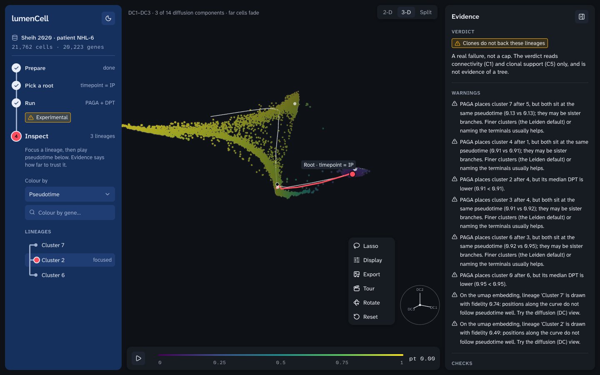
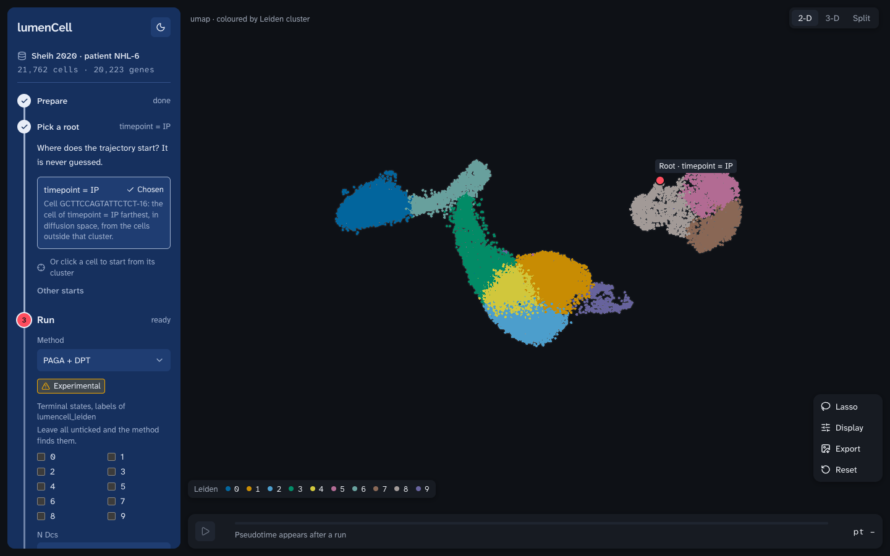
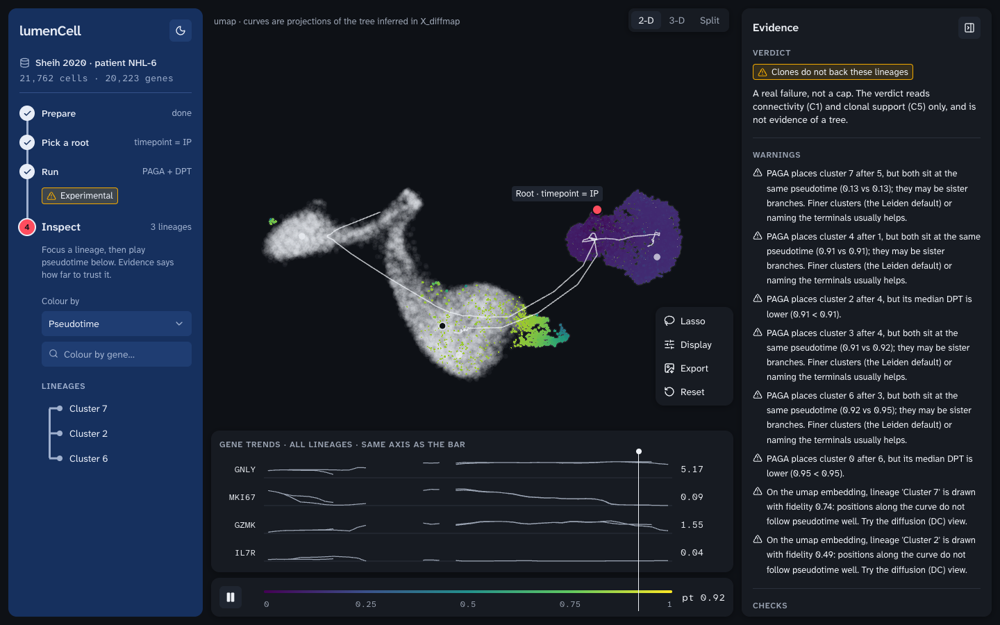
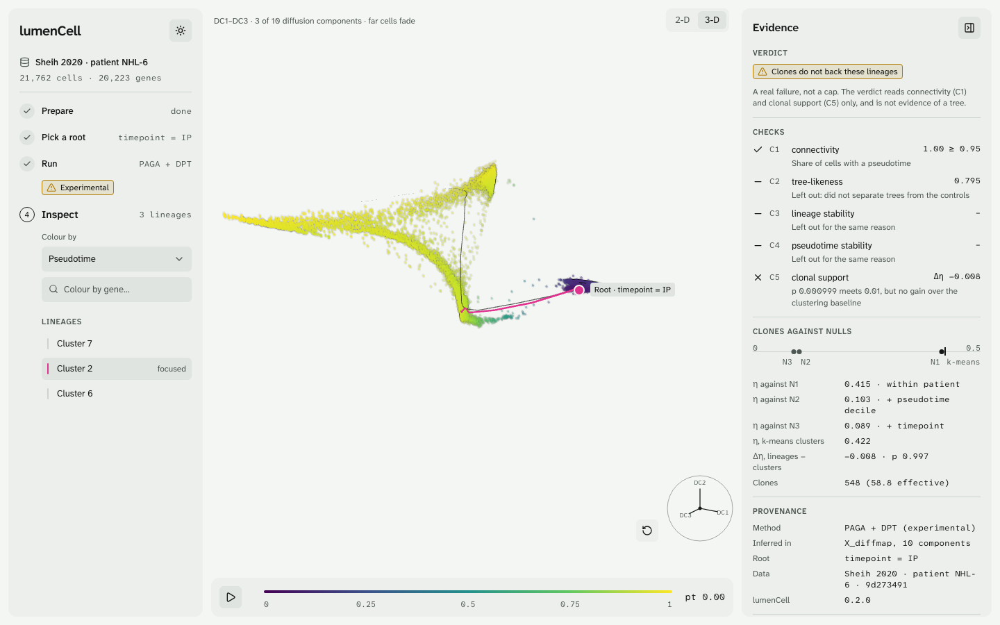
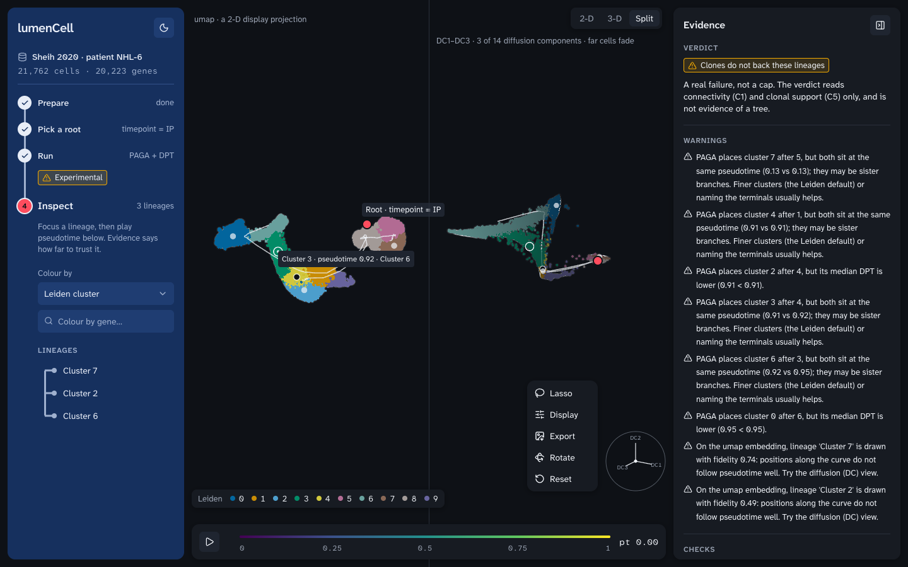
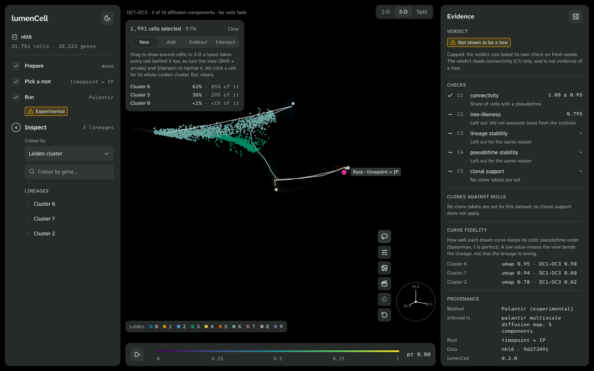
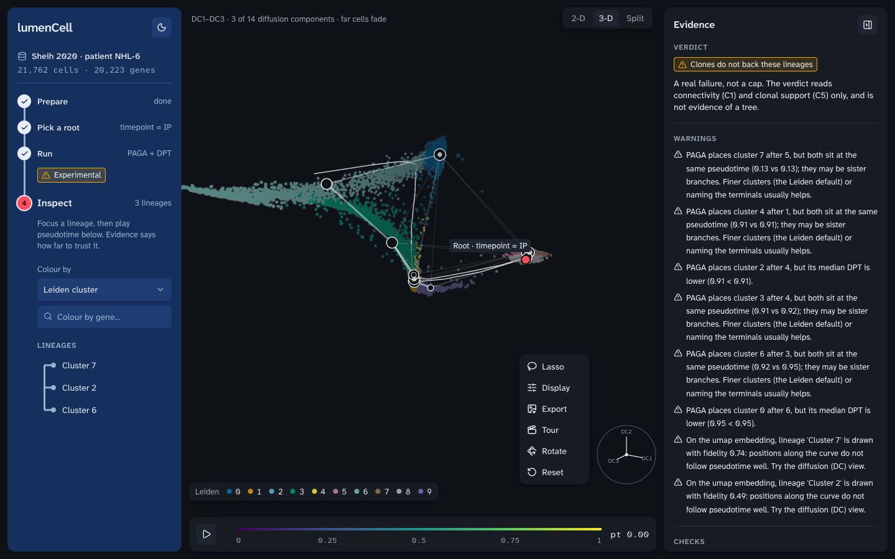

# lumenCell

Interactive explorer for pseudotime and lineage trajectories in single-cell RNA-seq data.

`lumencell launch data.h5ad` prepares the data in the background, asks where the
trajectory starts, runs a trajectory method, and lets you inspect lineages, gene
trends along pseudotime and how far to trust the result, in the browser.



CAR T cells from patient NHL-6 (Sheih 2020) on diffusion components 1 to 3, with the
trajectory's lineages drawn through them. The Evidence sheet on the right rates the run
weak: clones do not back these lineages any better than plain expression clusters do.

<table>
  <tr>
    <td></td>
    <td></td>
    <td></td>
  </tr>
  <tr>
    <td>You choose where the trajectory starts; it is never guessed.</td>
    <td>Play pseudotime: gene trends share the bar's axis and cursor.</td>
    <td>The light theme.</td>
  </tr>
</table>

<table>
  <tr>
    <td></td>
    <td></td>
    <td></td>
  </tr>
  <tr>
    <td>Split view: the 2-D embedding and DC1–DC3 side by side, with one hover, selection and cursor.</td>
    <td>Lasso cells in 2-D or 3-D; turn the view and intersect to narrow a selection.</td>
    <td>PAGA and the neighbour graph drawn over any view, on any three diffusion components.</td>
  </tr>
</table>

The address bar always names the view on screen (run, colouring, cameras, cursor, axes), so a
link reopens it; Export PNG saves the plot with its legend and where it came from.

Results so far: [docs/results.md](docs/results.md)

> **Known limits.** Every method is labelled experimental: each misses at least one
> benchmark gate. The misses are about branch structure (where lineages split), not
> pseudotime order, which agrees with the known stages on all three real datasets
> (Spearman 0.72 to 0.95). Only bone marrow has the two passing methods the plan asked
> for. The trust panel shows each method's reference results, failures included.
> Tuning the branch settings further was declined: the held-out datasets have already
> been measured, so a gain could not be shown to carry over. See the benchmark below.

## Principles

- **The root is never guessed.** Pseudotime is measured from a start you choose
  (`--root cluster:<column>=<value>`, a cell, or a root stored in the file).
  Suggestions come with their evidence and are never applied for you.
- **Inference runs in PCA / diffusion space, never on the UMAP.** Curves drawn on a
  2-D embedding are projections, labelled as such, with a fidelity check.
- **Accuracy is measured, not assumed.** Every method is benchmarked against known
  trajectories, and a method that misses any gate is marked experimental in the app.
- **Your file is never modified.** Results live in a cache; `lumencell export`
  writes them into a copy.

## Quick start

```bash
pip install lumencell
lumencell demo
```

`lumencell demo` opens a small synthetic dataset with a stored root. For your own data:

```bash
lumencell launch your-data.h5ad --root "cluster:clusters=Ductal"
```

`X` (or `layers["counts"]` / `.raw`) should hold raw counts, or log-normalised values.

Other commands: `lumencell prepare` (precompute), `lumencell roots` (suggestions),
`lumencell run` (run from the terminal; add `--clone-key` with `--donor-key` or `--single-donor`,
and optionally `--strata`, to score the run against clone labels), `lumencell export` (write results into a
copy of the file), `lumencell synth` (synthetic data with a known trajectory; `--fate-bias` adds
clone and donor columns).

## Methods

| Method | Install | What it is |
|---|---|---|
| PAGA + DPT | core | Diffusion pseudotime with lineages along the PAGA cluster tree (scanpy) |
| Palantir | `[palantir]` | Waypoint pseudotime and fate probabilities from a Markov chain (Setty et al. 2019) |
| scFates | `[scfates]` | A principal tree fitted in diffusion space; the drawn curve is the fitted tree |

The `palantir` and `scfates` extras pull in GPL-licensed dependencies (mellon,
elpigraph); lumenCell itself is MIT and only imports them.

## Benchmark

Synthetic data (Splatter-style counts from a known tree, no embedding given) runs
in CI; real datasets are a release gate (`lumencell bench fetch all`, then
`make bench-real`). Gates and every change to them are in
[`benchmarks/thresholds.toml`](benchmarks/thresholds.toml).

Full tables: [docs/benchmarks.md](docs/benchmarks.md).

## Development

Picking the project up? Start with [`docs/HANDOFF.md`](docs/HANDOFF.md): state, decisions, open work.

From a clone, with Python 3.13, [uv](https://docs.astral.sh/uv/) and Node 22+:

```bash
make install   # uv sync --all-extras + npm ci (the palantir/scfates extras are optional)
make web-dist  # build the web app into the package
make ci        # lint, types, tests, API contract check, web build, end-to-end test
make dev-server   # API on :8765 with a synthetic dataset; then `make dev-web` for the app on :5173
```
